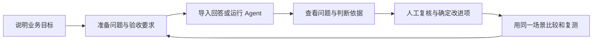

# Agent EVO · 评测与改进工作台

EVO 面向开发问答与多轮 Agent 的产品、业务和研发团队。它将测试要求、实际回答、评审理由和执行记录放在一起，支持审核问题、比较版本，并在修复后安排复测。

当前已公开平台源码、本地运行指南与在线案例。浏览已有记录无需 API Key；AI 出题、评审和报告需要配置自己的模型凭证。

[在线评测案例](https://dominicspace-agent-showcase.peterzhukejie2020.chatgpt.site/apps/evaluation/index.html?space=history&view=story) · [产品设计](docs/product-design.md) · [本地运行](docs/local-setup.md)

## 给谁用、完成什么

| 使用者 | 在 EVO 中完成的任务 | 得到什么 |
| --- | --- | --- |
| 产品负责人 | 整理测试要求，汇总问题，比较版本 | 可讨论的改进项、优先级与复测安排 |
| 业务审核者 | 对照问答、参考材料和预期，确认或修正评审 | 带原文与理由的审核记录 |
| 开发与交付人员 | 接入应用，复现问题，提交新结果 | 输入、执行依据和前后版本的比较材料 |

已有回答可直接导入，首次使用无需先接入完整 Agent。当前聚焦已有问答和多轮对话应用的小团队。

## 从已有材料开始

| 手头的材料 | 入口 | 后续工作 |
| --- | --- | --- |
| Excel、CSV 或 JSON 问答记录 | 导入回答并核对字段 | 按要求评审，人工确认问题 |
| 可调用的 Agent | 配置 HTTP / Python 连接器 | 运行测试集，保留回答与版本 |
| 产品说明，尚无测试题 | 说明用户、任务与边界，让 AI 草拟 | 修改并确认预期，保存题库版本 |




处理过程默认显示中文动作、结果与状态；点击步骤查看输入和结果，再展开原始执行记录。多轮对话和补充检索分别保留，操作见[本地查看说明](docs/local-setup.md#查看一条记录的处理过程)。

## 核心案例：信息更正失败的审核与复测

用户将病程从“两周”更正为“三天”，要求总结，Agent 却再次返回通用补充信息提示。案例展示审核者如何核对原文、修正评审意见、查看执行依据，并保存修复后的验证要求。

[阅读核心案例](docs/cases/correction-review.md) · [打开历史记录](https://dominicspace-agent-showcase.peterzhukejie2020.chatgpt.site/apps/evaluation/index.html?space=history&view=story) · [查看原文摘录](docs/cases/evidence/clinical-correction.json)

记录来自虚构病例的实际测试，尚无修复后的同条件复测。另有[回答导入模板](web/public/templates/answers.csv)，包含故意使用旧会议时间的合成例子，可直接导入练习审核。

## AI 与人工怎样分工

| 能力 | 用途 | 人工确认 |
| --- | --- | --- |
| 测试题草拟与独立检查 | 展开典型、缺失、边界和多轮场景，检查重复与冲突 | 代表性、业务预期、参考依据与题库版本 |
| 模型辅助评审 | 结合问答与验收要求找遗漏，给出引文和理由 | 判断是否成立，材料是否足够 |
| 报告整理 | 汇总已保存的问题和后续建议 | 优先级、责任与下一轮安排 |
| 规则检查 | 核对格式、字段等明确要求 | 规则与适用范围 |

当前主要接入阿里云百炼的模型服务，其他厂商接口尚不能直接替换。团队确定业务标准与发布决定，模型生成的题目和评审意见均可修改、确认。

## 关键设计

已有回答先审核，需要重复运行时再接入 Agent。应用可以留在原电脑、内网或云服务中，由开发者配置连接器领取任务、传回结果。

审核页将要求、实际回答、引文与处理过程并列；证据不足的判断保持待确认。人工修改意见保留原判断与理由，确认的问题可归组并保存回归场景。

版本比较记录题库、程序和评审规则。条件变动时先核对可比性，再决定比较范围；未提交修复后运行的问题保持待复测。详细异常与验收计划见[产品设计](docs/product-design.md)。

## 在线体验

[公开案例](https://dominicspace-agent-showcase.peterzhukejie2020.chatgpt.site/apps/evaluation/index.html?space=history&view=story)可直接查看对话、处理过程与判断依据；[自己的评测空间](https://dominicspace-agent-showcase.peterzhukejie2020.chatgpt.site/apps/evaluation/index.html?space=mine&view=evaluate)支持导入材料、准备测试集和后续评审。

## 需求来源与我的工作

项目来自我迭代 UniHR 和 Clinical Agent 的需要：保存失败输入和预期，修改后用相同场景检查效果。我负责评测流程、审核体验、问题跟进与验收要求，并借助 AI 编程工具实现平台。

下一步请首次使用者完整走一遍导入、审核和保存复测要求，记录卡点、评审分歧及配置成本，再调整入口与规则。

## 在本地运行

需要 **Python 3.12+、uv、Node.js 24+ 和 npm**。推荐 Python 3.12；Node 24 用于工作台的 SQLite 服务。

```bash
git clone https://github.com/DominicHongliDing/Agent-EVO.git
cd Agent-EVO
uv sync --python 3.12 --extra dev --locked
npm --prefix web ci
npm --prefix web run build
uv run uvicorn agent_evo.api:app --host 127.0.0.1 --port 8090
```

打开 <http://127.0.0.1:8090/?space=native&view=evaluate>。首次体验可以导入[合成回答模板](web/public/templates/answers.csv)，无需启动 UniHR 或 Clinical 服务。AI 出题、评审和报告需要另行配置模型凭证。

详细步骤、模型配置、连接器示例和常见问题见[本地运行指南](docs/local-setup.md)。

## 源码里有什么

| 目录 | 内容 |
| --- | --- |
| [`web/`](web/) | React 工作台：测试材料、回答审核、问题跟进、版本对比与报告 |
| [`src/agent_evo/`](src/agent_evo/) | FastAPI 本地服务、执行记录、规则检查、评审和报告任务 |
| [`integrations/workbench/`](integrations/workbench/) | 本地与托管适配共用的项目、任务、题库、评审和改进逻辑 |
| [`examples/`](examples/) | HTTP / Python 连接器及 Dify、LangChain、LangGraph 适配示例 |
| [`datasets/`](datasets/) / [`fixtures/`](fixtures/) | 合成测试材料，保留早期 UniHR / Clinical 接口与行为测试 |
| [`tests/`](tests/) | 后端回归测试；前端与工作台测试位于各自目录 |

架构与数据流见[技术说明](docs/architecture.md)，公开材料范围见[数据与发布说明](docs/data-and-release.md)。这个仓库包含 EVO 平台源码，UniHR 与 Clinical 是独立产品，不随本仓库安装。

## 当前实现与后续验证

已实现回答导入、测试集草拟与审核、Agent 连接、评审复核、问题归组、版本比较、回归任务和报告导出。

HTTP / Python 是主要接入方式，Dify、LangChain、LangGraph 等适配样例需按应用调整。外部使用价值与业务评分规则仍待试用校准。

---

作者：[丁泓力 · Hongli](https://github.com/DominicHongliDing)。相关项目： [UniHR AgentOS](https://github.com/DominicHongliDing/UniHR-AgentOS) 与 [Clinical Agent](https://github.com/DominicHongliDing/Clinical-Agent)。
