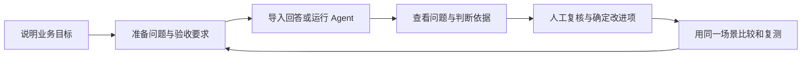

# Agent EVO · 评测与改进工作台

给正在改进 Agent 的产品、业务和开发同事使用，可以导入回答、准备测试题、比较版本，并跟进发现的问题。

产品改了提示词、模型或检索方式后，可以用原来的场景再测一次，核对哪些问题解决了，哪些还在。

[在线体验](https://dominicspace.com/apps/evaluation/index.html) · [看一个评测案例](https://dominicspace.com/apps/evaluation/index.html?space=history&view=story) · [产品设计](docs/product-design.md) · [本地运行](docs/local-setup.md) · [接入自己的 Agent](web/public/templates/connector-guide.md)

## 为什么做 EVO

做 UniHR 和 Clinical Agent 时，我遇到过一些演示里不容易看出来的问题：文件生成了，但少了用户要求的字段；医生更正了病例信息，下一轮回答却仍沿用旧条件。更换提示词或者模型以后，原来的问题可能好了，也可能在别的场景里出现新的遗漏。

这些问题只靠记忆很难跟进。我开始把测试问题、预期和实际回答一起保存，改完再拿同一道题验证。EVO 就是沿着这个过程做出来的。

## 给谁用

| 使用者 | 常遇到的问题 | 在 EVO 里完成的工作 |
| --- | --- | --- |
| 产品负责人 | 反馈很多，不知道先改哪里，也很难比较两个方案 | 把业务目标写成测试要求，汇总问题，比较版本，安排回归验证 |
| 业务审核者 | 评分缺少上下文，难以判断结论是否符合实际 | 对照原始问答、参考材料和预期要求，确认或修正判断 |
| 开发与交付人员 | “效果不好”的反馈太笼统，修完也缺少复测依据 | 接入业务入口，保留执行记录，用同一组问题核对修复结果 |

当前主要面向已有问答或多轮对话 Agent 的小团队。产品人员可以先从已有回答开始，不必等到完整接入后才开展评测。

## 从手头已有的材料开始

| 手头有什么 | 怎样开始 | 得到什么 |
| --- | --- | --- |
| 已有问答、客服对话或测试记录 | 导入 Excel、CSV 或 JSON，核对问题与回答 | 可以逐条审核的记录，以及按标准生成的评审结果 |
| 已有可调用的 Agent | 准备测试集，通过 HTTP 或 Python 连接器运行 | 新的回答、会话与版本记录，可用于方案对比 |
| 只有产品说明，还没整理测试题 | 写清服务对象、典型任务和不能做的事，让 AI 起草 | 待人工修改和确认的测试题，再冻结成可复用版本 |




## 一个例子：用户改了时间，Agent 还记着旧安排

第一轮，用户说“周三下午开会”。第二轮，用户改成“周四上午”，Agent 却仍然回答“周三下午”。如果只看回答是否通顺，这条记录很容易被放过去。

在 EVO 中，这个场景会被写成一个明确要求：**后续回答采用用户最新确认的时间**。评审时保留前后两轮内容，指出哪句话与要求不符；人工确认后，把它留下来做回归题。调整上下文处理方式后，再用这道题比较两个版本。

仓库自带的[回答模板](web/public/templates/answers.csv)保留了这个故意答错的合成例子，可以直接导入查看。在线还有一个 [Clinical 多轮更正案例](https://dominicspace.com/apps/evaluation/index.html?space=history&view=story)。

## AI 在里面做什么

| 能力 | 在产品中的作用 | 人需要确认什么 |
| --- | --- | --- |
| 大模型生成测试草稿 | 把产品说明展开为日常任务、信息不足、边界和多轮更正等场景 | 场景是否有代表性，预期是否符合业务 |
| 独立检查测试题 | 检查覆盖缺口、重复问题、预期冲突和参考依据 | 修改有争议的题目，再确认题库版本 |
| 模型辅助评审 | 结合问题、回答、参考材料和验收要求，找出遗漏并引用依据 | 判决是否成立，证据不足的部分是否需要补充 |
| 报告整理 | 将已保存的评审结果组织成问题说明和后续建议 | 优先级、责任分工，以及是否进入下一轮验证 |

格式、字段和已定义的约束由规则检查处理。AI 负责需要语义理解的部分；业务标准和发布决定仍由团队掌握。当前模型服务接入以阿里云百炼为主，不是所有厂商接口都可直接替换。

## 几个设计考虑

检查当前质量、比较两个版本、验证一个已知问题，需要看的材料不完全相同，所以开始时先选择评测目的，再进入对应步骤。

审核一条问题时，可以同时查看用户输入、实际回答、预期和引用；如果接入了执行步骤，还能继续检查过程。证据不足的部分标为待判断。

人工确认的问题可以留作回归测试。比较版本时一起记录题库、评审规则和执行版本，条件不一致的记录单独展示，不计算同题改善分数。

Agent 可以继续运行在自己的电脑、内网或云服务中。开发者配置连接器后，由它领取任务并回传结果，产品和业务同事再审核这些材料。

更完整的取舍与后续验证计划见[产品设计说明](docs/product-design.md)。

## 在本地运行

需要 **Python 3.12+、uv、Node.js 24+ 和 npm**。推荐 Python 3.12；Node 24 用于工作台的 SQLite 服务。

```bash
git clone https://github.com/DominicHongliDing/Agent-EVO.git
cd Agent-EVO
uv sync --python 3.12 --extra dev --locked
npm --prefix web ci
npm --prefix web run build
uv run uvicorn agent_evo.api:app --host 127.0.0.1 --port 8090
```

打开 <http://127.0.0.1:8090/?space=native&view=evaluate>。首次体验可以导入[合成回答模板](web/public/templates/answers.csv)，无需启动 UniHR 或 Clinical 服务。AI 出题、评审和报告需要另行配置模型凭证。

详细步骤、模型配置、连接器示例和常见问题见[本地运行指南](docs/local-setup.md)。

## 源码里有什么

| 目录 | 内容 |
| --- | --- |
| [`web/`](web/) | React 工作台：测试材料、回答审核、问题跟进、版本对比与报告 |
| [`src/agent_evo/`](src/agent_evo/) | FastAPI 本地服务、执行记录、规则检查、评审和报告任务 |
| [`integrations/workbench/`](integrations/workbench/) | 本地与托管适配共用的项目、任务、题库、评审和改进逻辑 |
| [`examples/`](examples/) | HTTP / Python 连接器及 Dify、LangChain、LangGraph 适配示例 |
| [`datasets/`](datasets/) / [`fixtures/`](fixtures/) | 合成测试材料，保留早期 UniHR / Clinical 接口与行为测试 |
| [`tests/`](tests/) | 后端回归测试；前端与工作台测试位于各自目录 |

架构与数据流见[技术说明](docs/architecture.md)，公开材料范围见[数据与发布说明](docs/data-and-release.md)。这个仓库包含 EVO 平台源码，UniHR 与 Clinical 是独立产品，不随本仓库安装。

## 当前进展

已实现回答导入、测试集草拟与审核、Agent 连接、评审复核、问题归组、版本比较、回归任务和报告导出。HTTP / Python 是主要接入方式，框架适配器需要按实际应用调整。

接下来需要请实际使用者试一遍：能不能自己准备有效的题目，是否看得懂评审理由，看完后能否确定先改什么。不同业务的评分标准也还需要校准。

---

作者：[丁泓力 · Hongli](https://github.com/DominicHongliDing)。相关项目： [UniHR AgentOS](https://github.com/DominicHongliDing/UniHR-AgentOS) 与 [Clinical Agent](https://github.com/DominicHongliDing/Clinical-Agent)。
