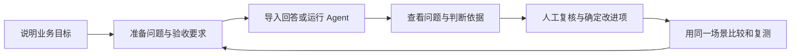
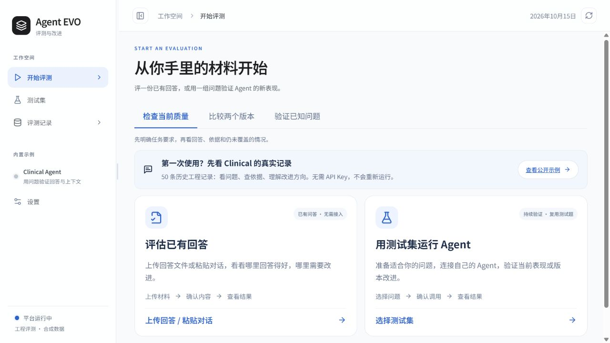

# Agent EVO · 评测与改进工作台

EVO 帮助产品、业务和开发同事一起检查 Agent 的表现。你可以从已有回答开始，准备测试题、查看问题，再比较不同版本的结果。

修改提示词、模型或检索方式后，用原来的场景再测一次，就能具体核对哪些问题修好了、哪些还在。

[看一次评测](https://dominicspace-agent-showcase.peterzhukejie2020.chatgpt.site/apps/evaluation/index.html?space=history&view=story) · [自己试一遍](https://dominicspace-agent-showcase.peterzhukejie2020.chatgpt.site/apps/evaluation/index.html?space=mine&view=evaluate) · [核心案例](docs/cases/correction-review.md) · [产品设计](docs/product-design.md) · [本地运行](docs/local-setup.md) · [接入自己的 Agent](web/public/templates/connector-guide.md)

## 第一次看，从一个出错的回答开始

[打开案例导览](https://dominicspace-agent-showcase.peterzhukejie2020.chatgpt.site/apps/evaluation/index.html?space=history&view=story)，按这三个步骤阅读，无需配置 API Key：

1. **先看实际对话**：用户把“两周”改为“三天”，AI 却没有按新信息作出总结。
2. **回看处理过程**：默认用中文说明做了什么，点击步骤看输入和结果，再展开查看原始执行记录。
3. **核对判断依据**：对照原文与评审意见，区分已经发现的问题和还需要确认的原因。

这里展示虚构病例的实际历史测试，保留了出错的回答；尚未记录修复后在相同条件下的测试结果。浏览记录不调用模型，自己进行 AI 出题、评审或分析时才需要配置个人 API Key。

## 为什么做 EVO

做 UniHR 和 Clinical Agent 时，我遇到过一些演示里不容易看出来的问题：文件生成了，但少了用户要求的字段；医生更正了病例信息，下一轮回答却仍沿用旧条件。更换提示词或者模型以后，原来的问题可能好了，也可能在别的场景里出现新的遗漏。

只靠记忆，很难判断每次修改究竟改善了什么。我开始把问题、预期结果和实际回答放在一起保存，改完再拿同一道题验证。后来，我把这些步骤整理成了 EVO，希望产品、业务和开发同事能围绕同一条记录讨论问题、跟进修复。

## 给谁用

| 使用者 | 常遇到的问题 | 在 EVO 里完成的工作 |
| --- | --- | --- |
| 产品负责人 | 反馈很多，不知道先改哪里，也很难比较两个方案 | 把业务目标写成测试要求，汇总问题，比较版本，安排回归验证 |
| 业务审核者 | 评分缺少上下文，难以判断结论是否符合实际 | 对照原始问答、参考材料和预期要求，确认或修正判断 |
| 开发与交付人员 | “效果不好”的反馈太笼统，修完也缺少复测依据 | 接入业务入口，保留执行记录，用同一组问题核对修复结果 |

当前主要面向已有问答或多轮对话 Agent 的小团队。产品人员可以先从已有回答开始，不必等到完整接入后才开展评测。

## 从手头已有的材料开始

| 手头有什么 | 怎样开始 | 得到什么 |
| --- | --- | --- |
| 已有问答、客服对话或测试记录 | 导入 Excel、CSV 或 JSON，核对问题与回答 | 可以逐条审核的记录，以及按标准生成的评审结果 |
| 已有可调用的 Agent | 准备测试集，通过 HTTP 或 Python 连接器运行 | 新的回答、会话与版本记录，可用于方案对比 |
| 只有产品说明，还没整理测试题 | 写清服务对象、典型任务和不能做的事，让 AI 起草 | 经人工修改、确认后保存的测试集，后续可以重复使用 |





记录中的“处理过程”先用中文说明每一步做了什么，点击后查看输入与结果，再展开核对原始执行记录。产品、业务和开发同事可以从同一个步骤逐层查看依据。多轮对话与补充检索分别保留，具体操作见[本地查看说明](docs/local-setup.md#查看一条记录的处理过程)。

## 一个例子：用户改了时间，Agent 还记着旧安排

用户先说“周三下午开会”，随后改成“周四上午”，Agent 却还是按周三下午安排。如果只看最后一句回答是否通顺，就可能漏掉这个错误。

在 EVO 中，可以为这个场景写下明确要求：**后续回答采用用户最新确认的时间**。审核时对照前后两轮内容，标出哪句话没有做到。确认问题后，保存这道题；调整上下文处理方式后再测一次，看看回答有没有变化。

仓库自带的[回答模板](web/public/templates/answers.csv)保留了这个故意答错的合成例子，可以直接导入查看。在线还有一个 [Clinical 多轮更正案例](https://dominicspace-agent-showcase.peterzhukejie2020.chatgpt.site/apps/evaluation/index.html?space=history&view=story)。

## 把一条问题讲清楚，再安排复测

[从病例更正失败到复测要求](docs/cases/correction-review.md)，展开了同一条记录怎样供产品、业务和开发共同核对：先确定未满足的要求，再查看引文与处理过程，修正不准确的评审意见，最后保存后续验证条件。

这也是对 EVO 本身的要求：首次使用者能不能找到依据，确认问题，并知道下一步该做什么。[产品设计说明](docs/product-design.md)补充了范围选择、AI 与人工分工、异常处理和使用验证计划。

## AI 在里面做什么

| 能力 | 在产品中的作用 | 人需要确认什么 |
| --- | --- | --- |
| 大模型生成测试草稿 | 把产品说明展开为日常任务、信息不足、边界和多轮更正等场景 | 场景是否有代表性，预期是否符合业务 |
| 独立检查测试题 | 检查覆盖缺口、重复问题、预期冲突和参考依据 | 修改有争议的题目，再确认题库版本 |
| 模型辅助评审 | 结合问题、回答、参考材料和验收要求，找出遗漏并引用依据 | 评审理由是否合理，还需不需要补充材料 |
| 报告整理 | 将已保存的评审结果组织成问题说明和后续建议 | 优先级、责任分工，以及是否进入下一轮验证 |

格式、字段等有明确要求的内容可以用规则检查，需要理解语义的部分由 AI 辅助判断。团队负责确定业务标准，并决定是否发布。当前主要接入阿里云百炼的模型服务，其他厂商接口还不能直接替换使用。

## 几个设计考虑

检查当前质量、比较两个版本、验证一个已知问题，需要看的材料不完全相同，所以开始时先选择评测目的，再进入对应步骤。

审核时，把用户输入、实际回答、预期要求和引用放在一起，方便判断哪里出了问题。如果接入了执行记录，还能继续查看过程；材料不足以得出结论的地方，先留下来待确认。

人工确认的问题可以保存下来，修复后重新测试。比较版本时，也要记录使用了哪套题、哪版程序和什么评审规则。条件不同的结果分开展示，不直接计算改善分数。

评测时，Agent 可以继续在原来的电脑、内网或云服务中运行。开发者配置连接器，由它领取测试任务、传回结果，产品和业务同事再查看和审核。

更完整的取舍与后续验证计划见[产品设计说明](docs/product-design.md)。

## 在本地运行

需要 **Python 3.12+、uv、Node.js 24+ 和 npm**。推荐 Python 3.12；Node 24 用于工作台的 SQLite 服务。

```bash
git clone https://github.com/DominicHongliDing/Agent-EVO.git
cd Agent-EVO
uv sync --python 3.12 --extra dev --locked
npm --prefix web ci
npm --prefix web run build
uv run uvicorn agent_evo.api:app --host 127.0.0.1 --port 8090
```

打开 <http://127.0.0.1:8090/?space=native&view=evaluate>。首次体验可以导入[合成回答模板](web/public/templates/answers.csv)，无需启动 UniHR 或 Clinical 服务。AI 出题、评审和报告需要另行配置模型凭证。

详细步骤、模型配置、连接器示例和常见问题见[本地运行指南](docs/local-setup.md)。

## 源码里有什么

| 目录 | 内容 |
| --- | --- |
| [`web/`](web/) | React 工作台：测试材料、回答审核、问题跟进、版本对比与报告 |
| [`src/agent_evo/`](src/agent_evo/) | FastAPI 本地服务、执行记录、规则检查、评审和报告任务 |
| [`integrations/workbench/`](integrations/workbench/) | 本地与托管适配共用的项目、任务、题库、评审和改进逻辑 |
| [`examples/`](examples/) | HTTP / Python 连接器及 Dify、LangChain、LangGraph 适配示例 |
| [`datasets/`](datasets/) / [`fixtures/`](fixtures/) | 合成测试材料，保留早期 UniHR / Clinical 接口与行为测试 |
| [`tests/`](tests/) | 后端回归测试；前端与工作台测试位于各自目录 |

架构与数据流见[技术说明](docs/architecture.md)，公开材料范围见[数据与发布说明](docs/data-and-release.md)。这个仓库包含 EVO 平台源码，UniHR 与 Clinical 是独立产品，不随本仓库安装。

## 当前进展

已实现回答导入、测试集草拟与审核、Agent 连接、评审复核、问题归组、版本比较、回归任务和报告导出。HTTP / Python 是主要接入方式，框架适配器需要按实际应用调整。

接下来想请实际使用者试一遍，看看准备测试题时会卡在哪里，评审理由是否容易理解，结果能否帮助他们决定先改什么。不同业务应该怎样评分，也需要继续和使用者讨论、调整。

---

作者：[丁泓力 · Hongli](https://github.com/DominicHongliDing)。相关项目： [UniHR AgentOS](https://github.com/DominicHongliDing/UniHR-AgentOS) 与 [Clinical Agent](https://github.com/DominicHongliDing/Clinical-Agent)。
