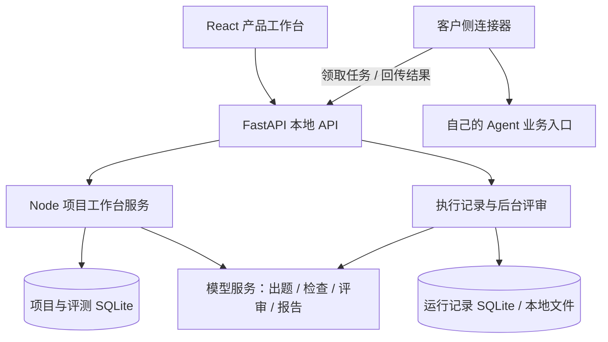

# 架构与实现入口

[返回项目首页](../README.md) · [本地运行](local-setup.md)

## 一次评测的数据如何流动

主服务监听 8090，自动启动只监听回环地址的 Node 服务（默认 8198），使用每次启动生成的内部令牌转发。通用项目、版本题库、任务、评审和改进项由共享工作台逻辑管理；早期 Clinical 专用执行与历史合同测试仍保留在 Python 层。

## 从哪些文件读起

| 问题 | 入口 |
| --- | --- |
| 用户如何创建项目、准备材料和运行评测？ | [`AgentWorkbench.tsx`](../web/src/AgentWorkbench.tsx)、[`EvaluationStart.tsx`](../web/src/EvaluationStart.tsx) |
| 题目、任务和连接如何持久化？ | [`core.mjs`](../integrations/workbench/core.mjs)、[`schema.sql`](../integrations/workbench/schema.sql) |
| 如何生成题目、检查覆盖与冲突？ | [`generation.mjs`](../integrations/workbench/generation.mjs)、[`draft-check.mjs`](../integrations/workbench/draft-check.mjs) |
| 如何保留评审依据与版本比较？ | [`judge.mjs`](../integrations/workbench/judge.mjs)、[`analysis.mjs`](../integrations/workbench/analysis.mjs) |
| 问题怎样变成可跟进的改进项？ | [`improvement.mjs`](../integrations/workbench/improvement.mjs) |
| 如何领取任务、恢复与提交结果？ | [`evo_connector.py`](../examples/evo_connector.py) |
| 怎样启动本地 API 与工作台？ | [`api.py`](../src/agent_evo/api.py)、[`workbench_api.py`](../src/agent_evo/workbench_api.py)、[`local-server.mjs`](../integrations/workbench/local-server.mjs) |

## AI 与规则各自负责什么

AI 负责测试草稿、语义评审和报告组织，规则负责字段、版本、任务状态和引用等校验。判决与引用保留为独立记录，人工复核和后续版本也分别保存。执行完成表示拿到了结果，是否符合业务要求仍需评审；这是内部状态设计，界面按具体问题向审核者解释。

连接器收到问题与会话信息，不收到评分预期。它在业务系统所在环境调用真实入口，默认回传回答与版本，执行步骤须显式启用。失败或租约过期不代表业务系统没有执行，应先核对已保存结果。

## 托管适配与本地运行的区别

[`integrations/sites/`](../integrations/sites/) 保留现有托管站点的 Worker 适配源码，依赖宿主注入静态资源、身份信息和数据库。它不是独立部署包；本次发布验证的是仓库根目录的本地启动方式。

尤其是共享服务中的身份头，必须由可信网关清理并注入，不能信任公网请求自己填写的身份值。完整共享部署还需要认证、域名允许列表、备份和凭证策略。本地 Node 服务强制使用本地工作区身份，并通过内部令牌限制访问。

在线 Clinical 展示、官网历史快照与可选 Langfuse 服务属于独立部署。源码中的相应适配入口不表示这些外部服务会随仓库启动，也不保证共享站点的可用性。
